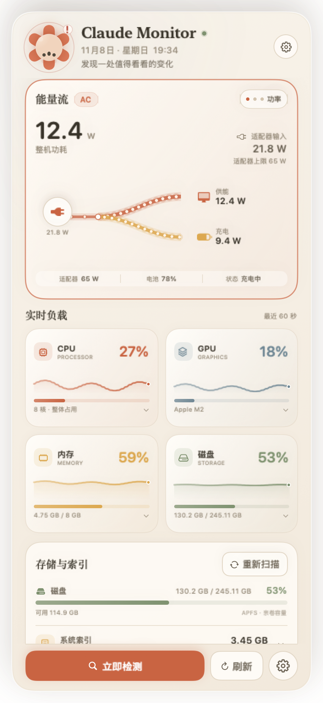
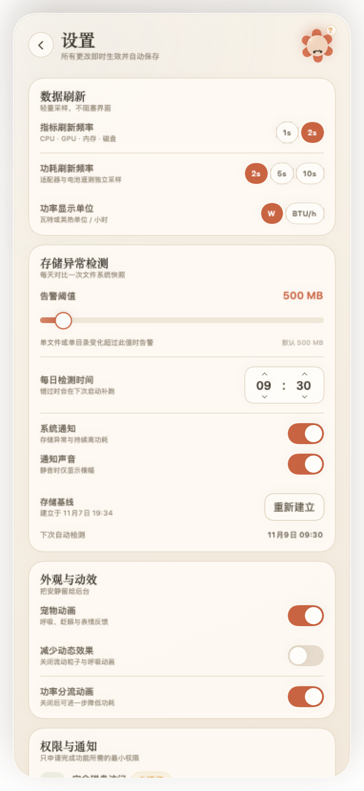

# Claude Monitor

[](https://github.com/even448/claude-monitor/actions/workflows/ci.yml)
[](LICENSE)

一款运行在 macOS 状态栏上的轻量级系统监控小工具。它把实时负载、功耗与充电分流、系统索引空间和每日存储异常，收进一块温暖、安静、带一点陪伴感的 Claude 风格面板里。

> 这是一个非官方概念项目，与 Anthropic 没有关联；界面灵感来自 Claude 的暖色、纸张感与陶土色视觉语言，未使用任何官方素材。


## v1.1 修复说明

- 修复 macOS 26/27 上“已授予完全磁盘访问，但 Spotlight 索引仍显示不可读”的误报。
- 改为检测真正受 TCC 保护的用户路径来判断 FDA；Spotlight 单独提供「管理员读取」入口。
- 由于构建使用 ad-hoc 签名，升级后需要在系统设置中重新添加本 App 的完全磁盘访问授权；Spotlight 管理员读取不依赖该授权。



| 设置面板 | 小 Claude 表情 |
| --- | --- |
|  |  |

更多素材：[完整长图（含异常报告）](Docs/images/panel-overview-full.png) · [设置全图](Docs/images/panel-settings-full.png) · [状态栏图标三态](Docs/images/status-icons.png) · [App Icon](Docs/images/app-icon.png)

---

## 功能一览

- **实时指标**：CPU、GPU、内存、磁盘；默认 2 秒刷新，也可切换为 1 秒。每张卡片有百分比、进度条与最近 60 秒迷你趋势图，悬停趋势图可查看时间点数值。
- **系统功耗**：整机功耗、适配器输入功率、电池充电功率；按「供能 / 充电」可视化分流，电池供电时自动反向为「电池 → 电脑」并显示剩余电量与续航估算。
- **功率流动画**：以带粒子的能量带表示电流方向；条带粗细、粒子数量与流速随功率变化，支持悬停高亮和点击切换「功率 / 占比 / 电池详情」。
- **系统索引空间**：扫描 `.Spotlight-V100`、`.fseventsd`、Spotlight 数据库、文稿版本等目录，显示总大小与占磁盘比例，支持手动重新扫描、分类展开；在 macOS 26/27 上提供管理员授权读取 Spotlight 的专用入口。
- **每日存储异常检测**：用 C/`fts` 快速扫描文件系统，生成每日快照；对比单文件或目录的体积变化，超过阈值时列出路径、前后大小、变化量与时间，并发送系统通知。
- **Claude 风格界面**：暖米白纸面、珊瑚陶土色、大圆角、留白与轻柔阴影；2×2 指标卡、功率分流画布、索引卡片和异常报告统一在同一套设计语言里。
- **矢量小 Claude**：完全由 SwiftUI 矢量绘制，六片圆润的陶土色花瓣、奶油色小脸；平静、好奇、关心、惊讶、工作、开心六种状态，带呼吸、眨眼、倾斜与点击回应。
- **顺手的状态栏交互**：点击图标 toggle 面板；面板淡入并轻微上移；点击外部或按 Esc 收起；↑ / ↓ 在区块间导航，Enter 执行焦点动作；过载时状态栏图标变红并轻微闪烁。
- **设置即时生效**：刷新频率、功率刷新频率、功率单位、异常阈值、每日检测时间、通知、宠物动画、减少动态效果、功率分流动画均可配置并持久化。

---

## 快速开始

### 直接运行构建好的 App

```bash
open "build/ClaudeMonitor.app"
```

也可以直接取用打包好的 [ClaudeMonitor-1.1-arm64.zip](https://github.com/even448/claude-monitor/releases/latest)。

应用没有 Dock 图标。启动后，在菜单栏右侧找到珊瑚色的六瓣小花图标，点击展开面板。

> 已构建的版本为 Apple Silicon (arm64)。Intel Mac 请按下文从源码重新构建。
>
> 首次打开若被 Gatekeeper 拦截，请右键 App → 打开。

### 从 GitHub 克隆源码

```bash
git clone https://github.com/even448/claude-monitor.git
cd claude-monitor
```

### 从源码构建

要求：

- macOS 12 或更高版本
- Xcode 15+（Swift 5.7+）或匹配的 Command Line Tools
- 无第三方依赖，无网络请求

方式 A：使用脚本构建 `.app`

```bash
./scripts/build-app.sh
open build/ClaudeMonitor.app
```

脚本会编译 Swift 源码和 `Sources/CStorageScanner` 中的 C 扫描器，生成 `build/ClaudeMonitor.app`，并使用 ad-hoc 签名。

方式 B：使用 Xcode

1. 打开 `Package.swift`（Xcode 15+ 支持 Swift Package 工程）。
2. 选择 `ClaudeMonitor` executable scheme，点击 Run。
3. 若要得到带 Info.plist、通知权限与完整 App 身份的应用，请优先使用方式 A 生成 `.app`。

如果本机的 Command Line Tools SDK 与 Swift 编译器版本不匹配（常见于只安装了 CLT 的机器），可显式指定：

```bash
CLAUDE_MONITOR_SWIFT_SDK=/path/to/MacOSX.sdk \
CLAUDE_MONITOR_SWIFT_RESOURCE_DIR=/path/to/usr/lib/swift \
./scripts/build-app.sh
```

### 运行测试

```bash
./scripts/smoke-test.sh
```

测试覆盖：

- C `fts` 扫描器的文件变化、目录聚合变化与 JSON 快照持久化；
- Spotlight / FSEvents 风格索引目录的实际字节统计。

---

## 权限说明

| 权限 | 用途 | 是否必需 |
| --- | --- | --- |
| 完全磁盘访问（Full Disk Access） | 读取 FSEvents、受保护用户目录，并得到完整的每日存储快照 | 推荐；没有时应用仍可运行，但 FSEvents 与异常报告可能不完整 |
| 管理员授权 | 通过 `mdutil -L` 读取 macOS 26/27 额外保护的 Spotlight 索引 | 仅在需要 Spotlight 索引大小时点击；每次读取由 macOS 弹窗授权，应用不保存密码 |
| 通知 | 存储异常与持续高功耗提醒，点击通知展开面板并定位到对应报告 | 可选，可在设置中关闭 |
| 辅助功能 / 输入监控 | 不需要 | — |
| 网络 | 不需要，应用没有网络代码 | — |

### 授权完全磁盘访问

1. 打开「系统设置」→「隐私与安全性」→「完全磁盘访问」。
2. 点击 `+`，选择 `build/ClaudeMonitor.app`。
3. 打开开关。
4. **退出并重新启动 Claude Monitor**，再打开设置中的「重新检查」或点击「重新扫描」。

应用刻意不启用 App Sandbox，以便在获得完全磁盘访问后读取受保护目录；应用只读取本地数据，不包含任何网络请求。ad-hoc 重签名会改变 TCC 身份，重新构建后需要重新授权。

### 为什么授予完全磁盘访问后 Spotlight 仍显示不可读？

这是 macOS 26/27 的系统保护差异，不是授权没有点开：

- `/System/Volumes/Data/.Spotlight-V100` 在 macOS 26/27 上对第三方 App 做了额外保护；即使有完全磁盘访问，也不能直接读取。
- 读取 Spotlight 索引的 `mdutil -L` 命令本身要求 **root**，不是 FDA。
- 旧版用 `.Spotlight-V100` 的 `isReadableFile` 结果判断 FDA，因此会误报“需要完全磁盘访问”。

当前版本已修正：

1. 用 `~/Library/Safari/History.db`、`~/Library/Messages/chat.db`、`~/Library/Mail`、`/Library/Application Support/com.apple.TCC/TCC.db` 等真正受 TCC 保护的路径判断 FDA 状态。
2. 在「存储与索引」卡片和设置中提供 **管理员读取 Spotlight** 按钮。点击后 macOS 会弹出管理员授权窗口，App 只执行 `/usr/bin/mdutil -L /System/Volumes/Data` 读取索引文件列表，不修改索引。密码由 macOS 处理，App 不接收也不保存。
3. 普通自动扫描（每 6 小时）不会弹管理员窗口；管理员读取只在用户明确点击时发生，并会缓存上一次结果。

完全磁盘访问仍然值得授予：FSEvents、受保护用户目录和完整异常快照仍依赖它。

### 更新后的重新授权

本项目使用 ad-hoc 签名，更新二进制会改变 App 的 code identity，macOS 不会自动沿用旧的 TCC 授权。更新后请：

1. 在设置底部「退出 Claude Monitor」完全退出；
2. 系统设置 → 隐私与安全性 → 完全磁盘访问，移除旧的 Claude Monitor 条目，重新添加 `build/ClaudeMonitor.app`；
3. 重新打开 App；
4. 在「存储与索引」卡片点击「管理员读取」，输入一次 macOS 管理员密码。

如果只想先看 Spotlight 大小，可以直接使用第 4 步的管理员读取；它不依赖完全磁盘访问。FSEvents 与完整异常快照则仍建议完成前 3 步。

### 通知

默认开启。检测到异常时会请求通知权限；也可以在「设置 → 权限与通知 → 请求通知权限」主动授权。点击通知或通知上的「查看详情」会激活面板并定位到对应区域。

---

## 技术方案摘要

完整的模块设计、公式与限制见 [Docs/TECHNICAL.md](Docs/TECHNICAL.md)。

### CPU / 内存 / 磁盘

- **CPU**：`host_processor_info(PROCESSOR_CPU_LOAD_INFO)` 计算每个核心与整体的 tick 差分；无 root。
- **内存**：`host_statistics64(HOST_VM_INFO64)`，使用 active + wired + compressed 作为「已用内存」；包含 swap 信息。
- **磁盘**：根宗卷的 `volumeTotalCapacity` / `volumeAvailableCapacity`。
- 刷新间隔默认 2 秒，允许 1 秒；不提供慢于 2 秒的选项。

### GPU

GPU 利用率通过公开的 IORegistry 属性读取：

```text
IOAccelerator → PerformanceStatistics → "Device Utilization %"
```

这是 Apple Silicon 和多数 Intel Mac 上无需 root 的读取方式。部分驱动或未来系统可能不发布该字段；应用会显示「不可用」，不会伪造数字。没有使用需要额外权限的 Metal 性能计数器，也没有使用私有 IOReport 接口。

### 功耗与充电

读取层分三档，逐级降级：

1. **Apple Silicon 首选**：`AppleSmartBattery` 的 `PowerTelemetryData`，其中包含 `SystemPowerIn`、`SystemLoad`、`BatteryPower`、`AdapterEfficiencyLoss` 等毫瓦级遥测。
2. **通用回退**：`AppleSmartBattery` 的电压/电流、适配器信息，以及 IOKit `AppleSMC` 只读键 `PSTR`（系统总功耗）、`PDTR`（DC-in 输入）、`PPBR`（电池功率）等。
3. **最后回退**：`IOPowerSources` 的电源状态、电量、剩余时间与适配器额定功率。

分流关系：

```text
chargeW = |Voltage × Amperage|      （充电时）
supplyW = inputW − chargeW          （供能部分）
systemW = supplyW                   （接入电源）
systemW = dischargeW                （电池供电）
```

充满或涓流时充电支路会自动变细或消失，仅保留供能支路。数据源不可直接测量时会退化为估算，界面显示「估算」小标签。

Apple Silicon 与 Intel 的具体差异、可获取性矩阵见技术文档。

### 系统索引空间

扫描位置：

- `/System/Volumes/Data/.Spotlight-V100`
- `/private/var/db/Spotlight`
- `/System/Volumes/Data/.fseventsd`
- `/System/Volumes/Data/.DocumentRevisions-V100`
- `~/Library/Metadata/CoreSpotlight`

普通目录按文件分配大小汇总，显示分类明细、总量与磁盘占比。macOS 26/27 的 `.Spotlight-V100` 需要用户点击「管理员读取」后，通过 `mdutil -L` 读取（文件长度合计，不含 Cache）；结果会缓存，并在之后的普通扫描中保留。

### 每日存储异常检测

- 使用 C `fts(3)` 物理遍历，性能明显优于逐文件 Foundation URL 资源查询；扫描在 utility QoS 后台队列执行。
- 记录单个文件 ≥ 10 MB 的分配大小，以及相对根目录深度 1–2、汇总大小 ≥ 20 MB 的目录体积。
- 跳过缓存、容器、iCloud、回收站、系统隐藏索引等噪声目录；默认根为 `~`、`/Applications`、`/Library`、`/private/var/db`、`/private/var/log`。
- 快照存储在 `~/Library/Application Support/ClaudeMonitor/storage-baseline.json`，异常报告同目录。
- 每日按设置时间自动对比；错过时间会在下次启动补跑。首次运行建立基线，不发送误报通知。
- 阈值默认 500 MB，可在 100 MB–5 GB 调整。
- 检测到异常时，面板会高亮异常区、让宠物做出惊讶表情，并发送系统通知。

### 宠物与功率流动画

- 宠物：[`PetMascotView.swift`](Sources/ClaudeMonitor/UI/PetMascotView.swift)，纯 SwiftUI 矢量绘制，不使用图片或 Lottie。
- 功率分流：[`EnergyCardView.swift`](Sources/ClaudeMonitor/UI/EnergyCardView.swift)，Canvas + 60 fps 轻量 ticker。面板隐藏或关闭动画时 ticker 立即停止。
- 设计素材与导出图见 [`Docs/images/pet-expressions.png`](Docs/images/pet-expressions.png) 和 [`Docs/images/status-icons.png`](Docs/images/status-icons.png)。

### 面板结构与交互

```text
Header（宠物 / 名称 / 日期时间 / 设置）
  └─ 功耗与充电区（数值 + 分流动画 + 电池详情）
       └─ 实时负载 2×2 卡片（悬停 / 点击展开）
            └─ 存储与索引（磁盘、索引、重新扫描）
                 └─ 异常变化报告（列表 / 查看全部 / 复制 / Finder）
                      └─ Footer（立即检测 / 刷新 / 设置）
```

- 状态栏使用 `NSStatusItem`，面板使用自定义 `NSPanel` + `NSHostingView`，以兼容 macOS 12（没有采用 macOS 13 才有的 `MenuBarExtra`）。
- 可见卡片宽度 354 pt（窗口 382 pt，包含阴影留白），高度按屏幕自适应并在内容过长时滚动。
- 目标部署版本：macOS 12.0；本地已在 Apple M2 / macOS 27.3 上构建并验证。

---

## 设置

| 设置项 | 默认值 | 说明 |
| --- | --- | --- |
| 指标刷新频率 | 2 s | 1 s / 2 s |
| 功耗刷新频率 | 2 s | 2 s / 5 s / 10 s |
| 功率显示单位 | W | W / BTU/h |
| 异常阈值 | 500 MB | 100 MB–5 GB |
| 每日检测时间 | 09:30 | 本机时区 |
| 系统通知 | 开 | 存储异常与持续高功耗 |
| 通知声音 | 开 | 关闭后静默横幅 |
| 宠物动画 | 开 | 呼吸、眨眼、表情 |
| 减少动态效果 | 关 | 关闭宠物动画与粒子流动 |
| 功率分流动画 | 开 | 关闭可进一步降低功耗 |
| 重新建立存储基线 | — | 清除当前基线与报告，重新建立 |

所有设置即时写入 `UserDefaults`，无需重启。

---

## 工程结构

```text
.
├── Package.swift
├── README.md
├── Sources
│   ├── ClaudeMonitor
│   │   ├── App              # 入口、状态栏、面板窗口、MonitorEngine
│   │   ├── Collectors       # CPU / 内存 / 磁盘 / GPU / 功耗 / SMC / 进程
│   │   ├── Storage          # 索引扫描、异常扫描、快照、调度器
│   │   ├── Notifications    # UserNotifications 封装
│   │   ├── UI               # 面板、卡片、宠物、功率流、设置
│   │   ├── Support          # 模型、主题、格式化、设置持久化
│   │   └── Rendering        # 离线预览与文档截图渲染器
│   └── CStorageScanner       # fts(3) 快速文件扫描器（C）
├── Resources                 # Info.plist、AppIcon.icns、icon-1024.png
├── Tests                     # 可独立编译的 smoke tests
├── scripts
│   ├── build-app.sh
│   ├── run.sh
│   ├── smoke-test.sh
│   └── make-icon.py
├── Docs
│   ├── TECHNICAL.md
│   └── images
└── build
    └── ClaudeMonitor.app
```

关键源码入口：

- 采样与调度：[`MonitorEngine.swift`](Sources/ClaudeMonitor/App/MonitorEngine.swift)
- 功耗：[`PowerSampler.swift`](Sources/ClaudeMonitor/Collectors/PowerSampler.swift)
- GPU：[`GPUSampler.swift`](Sources/ClaudeMonitor/Collectors/GPUSampler.swift)
- 索引：[`IndexScanner.swift`](Sources/ClaudeMonitor/Storage/IndexScanner.swift)
- 异常检测：[`StorageScanner.swift`](Sources/ClaudeMonitor/Storage/StorageScanner.swift)
- 面板：[`PanelView.swift`](Sources/ClaudeMonitor/UI/PanelView.swift)
- 宠物：[`PetMascotView.swift`](Sources/ClaudeMonitor/UI/PetMascotView.swift)
- 功率流：[`EnergyCardView.swift`](Sources/ClaudeMonitor/UI/EnergyCardView.swift)
- 设置：[`SettingsView.swift`](Sources/ClaudeMonitor/UI/SettingsView.swift)

---

## 本地验证结果

验证机器：MacBook Air (M2, 8 GB), macOS 27.3。

- CPU / GPU / 内存 / 磁盘均成功采集；GPU 来自 `IOAccelerator`，实测 `Device Utilization %`。
- 功耗实测：AC 供电、适配器 65 W、整机约 18–21 W、电池 100% 时充电支路为 0；`PowerTelemetryData` 与 SMC 均可用。
- 电池健康约 87.2%，循环 175 次，温度约 31°C。
- 一次完整扫描：805,787 个文件，文件记录 1,045 个、目录聚合 167 个，C 扫描基准约 22 秒；在应用 utility 队列下约 50 秒完成并生成 176 KB 基线。
- 键盘 Down / Enter / Esc 已验证：焦点移动、CPU 详情展开、Esc 关闭面板。
- 测试环境为 macOS 27.3，`.Spotlight-V100` 即使有完全磁盘访问也无法直接读取；已实测得到 `mdutil -L` 需要 root 的结果，并加入管理员读取路径。索引解析器与 AppleScript 命令均通过编译/解析测试。
- 更新为修复版后，ad-hoc 签名会改变，需在系统设置中重新添加本 App 的完全磁盘访问授权。

---

## 已知限制

- **GPU**：依赖驱动公开 `Device Utilization %`；不可用时显示「—」。这是有意避免私有 API / 额外权限的取舍。
- **功耗**：`PowerTelemetryData` 与部分 SMC 键属于未公开但长期稳定的系统数据，未来 macOS 可能改变；缺失时自动回退并在界面标记「估算」。适配器效率损耗未计入 UI 数值。
- **存储扫描范围**：为控制资源占用，默认跳过缓存、容器、iCloud、回收站等目录，只对用户数据、应用程序、`/Library` 与部分 `/private/var` 做快照。深度 2 以上只参与上层聚合，单文件记录下限为 10 MB。
- **完全磁盘访问**：未授权时 FSEvents 与异常报告不完整。授权后需要重启应用；重新签名后需要重新授权。
- **Spotlight 索引**：macOS 26/27 的 `.Spotlight-V100` 受额外系统保护，完全磁盘访问也不可直接读取，必须通过「管理员读取」调用 `mdutil -L`。这是一次用户主动触发的管理员授权，不能静默自动执行。
- **通知**：ad-hoc 签名应用的本地通知能力取决于系统策略；若通知被拒绝，面板内报告仍然正常工作。
- **发行**：未做 notarization，不适合直接分发给不受信任的用户；正式分发建议使用 Developer ID 签名与公证。

---

## 设计说明

- **配色**：纸面 `#F5EFE4` / `#FFFBF5`，墨色 `#39342A`，主珊瑚 `#C96442`，蜂蜜 `#DCA84F`，鼠尾草 `#7F9270`，警示 `#B84C3C`。
- **字体**：标题使用 New York / serif；数值使用 SF Rounded，层级清楚但不锐利。
- **留白与圆角**：卡片 16–22 pt 圆角，面板 24 pt 圆角；阴影只做轻柔抬起。
- **宠物造型**：六片胶囊花瓣 + 奶油色中心圆形脸；矢量路径和表情状态全部可在源码中调整。素材导出图在 `Docs/images/`。

---

## 许可与声明

本项目以 MIT License 开源，详见 [LICENSE](LICENSE)。

本项目为个人学习/创作性质的非官方概念应用，与 Anthropic 无关联。项目中没有包含 Anthropic 的官方商标素材；「Claude」名称仅用于说明视觉灵感。若需商业分发，请自行完成商标、隐私政策、签名与公证等合规工作。
